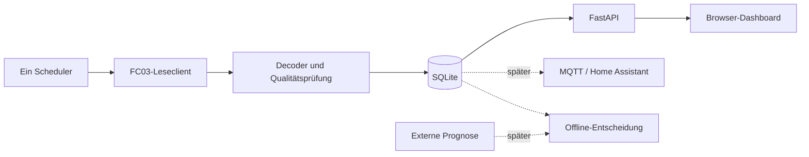

# Architektur und Modulgrenzen

Ein deploybarer Container: Python/FastAPI liefert API und gebautes React/TypeScript-
Frontend. Node wird nur zum Bauen benötigt. SQLite auf lokalem persistentem Volume.

## Komponenten

- Registerprofil: versionierte, freigegebene Gruppen; öffentliche Vollreferenz ist
  keine ausführbare Konfiguration. Nur die drei Kernblöcke sind Erstprofil-Kandidaten.
- Transport: enger FC03-Zugriff mit einer Deadline; streng MBAP/PDU/Unit/Transaktion
  prüfen. Fehler liefern Typ plus Anzahl bereits empfangener Bytes.
- Decoder: reine Funktionen, Signalherkunft und Gültigkeit. Kein I/O und keine
  stillschweigende Skalierung unbekannter Einträge.
- Sammler: endlicher Testmodus und später Dauerbetrieb; jeweils ein Besitzer der
  Geräteschnittstelle. Prozess-/Deployment-Sperre, kein Start pro Webworker.
- Repository/SQLite: Transaktionen für Messungen und Zustandswechsel; Ausfälle
  führen zum Stopp, statt weiter ungespeichert zu messen.
- API/UI: Lesen aus DB, kein Modbus beim HTTP-Refresh. Verwaltungsaktionen nur
  lokal in der App, validiert und zugriffsgeschützt.
- Ausgabeadapter später: MQTT unabhängig von der Verfügbarkeit des Brokers;
  Prognose und Steuerung bleiben getrennte Module und Datentypen.

## Konfiguration und Lebenszyklus

Die lokale Schnittstelle ist in `backend/config.py` umgesetzt; `.env.example` enthält
nur sichere Standardwerte. Unterstützte Variablen: `MODBUS_HOST` (optional),
`MODBUS_PORT`, `MODBUS_UNIT_ID`, `REGISTER_PROFILE`, `COLLECTOR_ENABLED`,
`DATA_DIR` und `DISPLAY_TIMEZONE`. `COLLECTOR_ENABLED` ist standardmäßig `false`;
bei aktivierter Erfassung ohne Host startet die Anwendung mit Konfigurationsfehler.
`/api/config` gibt nur `host_configured` statt des Hostwerts zurück und veröffentlicht
keinen privaten Datenpfad.

`uv.lock` sperrt Python-Abhängigkeiten; `package-lock.json` sperrt Frontendpakete.
Entwicklungsbasis: CPython 3.12.9, Node.js 22.14.0 und npm 10.9.2. Python 3.12
wird als konservative, von den benötigten Bibliotheken unterstützte Laufzeitreihe
verwendet; Node 22 ist die LTS-Reihe für den React/Vite-Build. CI und Lockdateien
fixieren reproduzierbare Eingaben. Änderungen dieser Versionen erfolgen bewusst
und zusammen mit aktualisierten Locks.

Der vorhandene API/UI-Startpunkt dient lokaler Offline-Entwicklung. Modbus-Transport,
Sammler, Datenbank und Auslieferung des UI aus dem API-Prozess folgen in späteren Issues.

Frische Installation: ohne konfiguriertes Ziel/Profil keine Geräteverbindung. Der
aktuelle Startpunkt führt überhaupt keine Modbus-Kommunikation aus; Profil `core`
bezeichnet nur den vorgesehenen künftigen Default. Kein automatischer Import,
keine Suche, keine alte Standard-IP. Ein später explizit eingerichteter Betrieb darf
nach normalem Neustart seinen dokumentierten Zustand wieder aufnehmen; harter Stopp,
manuelle Pause und Fehlerbudget bleiben erhalten. Keine Wiederaufnahme während
Backup/Restore oder bei fehlender Zustandsdatei nach bereits erkanntem Speicherfehler.
Die genaue Crash-Konsistenz wird in den Sammler-/Speicher-Issues getestet.

Shutdown: neue Anfragen sperren, laufende Anfrage höchstens bis Deadline beenden,
Speichertransaktionen abschließen, Zustand sichern, Verbindung schließen. Mehrere
Browser dürfen keine zusätzlichen Sammler starten. Das Deployment muss auch
konkurrierende Container für dieselbe Anlage verhindern bzw. erkennen; kein alleiniger
prozesslokaler Mutex als hinreichende Lösung behaupten.

Testbarkeit: Clock, Transport und Speichergrenzen injizierbar; Tests können Minuten
simulieren, ohne in Echtzeit zu warten. Änderungen an Laufzeiten erfolgen zusammen
mit aktualisierten Python-/npm-Locks und CI-Versionen.
