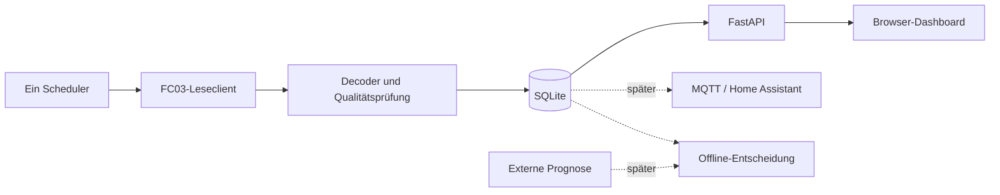

# Architektur und Modulgrenzen

Ein deploybarer Container: Python/FastAPI liefert API und gebautes React/TypeScript-
Frontend. Node wird nur zum Bauen benötigt. SQLite auf lokalem persistentem Volume.

## Komponenten

- Registerprofil: versionierte, freigegebene Gruppen; öffentliche Vollreferenz ist
  keine ausführbare Konfiguration. Das implementierte Erstprofil `core` enthält
  ausschließlich die drei bestätigten Blöcke in `backend/registers.py`.
- Transport: `backend/modbus.py` erzeugt ausschließlich FC03-Anfragen zu den exakten
  `core`-Blöcken, immer Unit 255, höchstens zwei Register und mit 3-s-Gesamtdeadline.
  Keine Wiederholungen. MBAP/PDU, Protokoll-ID, Länge, Transaktion, Unit, Funktion
  und Byteanzahl werden geprüft; Fehler enthalten empfangene Bytezahl.
- Decoder: reine Funktionen, Signalherkunft und Gültigkeit. Kein I/O und keine
  stillschweigende Skalierung unbekannter Einträge.
- Sammler: endlicher Testmodus und später Dauerbetrieb; jeweils ein Besitzer der
  Geräteschnittstelle. Prozess-/Deployment-Sperre, kein Start pro Webworker.
- Repository (`backend/storage.py`): versioniertes SQLite-Schema, atomare und
  idempotente Erfassungszyklen, Ereignis-/Zustands-/Konfigurationsspeicherung,
  begrenzte Chronologieabfragen, Online-Backup/Restore und Speicherfehler als
  `StorageError`. Anwendungsstart öffnet `/data/monitor.sqlite3` und prüft Migrationen;
  noch kein Sammler schreibt Daten.
- API/UI: Lesen aus DB, kein Modbus beim HTTP-Refresh. Verwaltungsaktionen nur
  lokal in der App, validiert und zugriffsgeschützt.
- Ausgabeadapter später: MQTT unabhängig von der Verfügbarkeit des Brokers;
  Prognose und Steuerung bleiben getrennte Module und Datentypen.

## Konfiguration und Lebenszyklus

Die lokale Schnittstelle ist in `backend/config.py` umgesetzt; `.env.example` enthält
nur sichere Standardwerte. Unterstützte Variablen: `MODBUS_HOST` (optional),
`MODBUS_PORT`, `MODBUS_UNIT_ID`, `REGISTER_PROFILE`, `COLLECTOR_ENABLED`,
`DATA_DIR` und `DISPLAY_TIMEZONE`. `COLLECTOR_ENABLED` ist standardmäßig `false`;
bei aktivierter Erfassung ohne Host startet die Anwendung mit Konfigurationsfehler.
`/api/config` gibt nur `host_configured` statt des Hostwerts zurück und veröffentlicht
keinen privaten Datenpfad.

`uv.lock` sperrt Python-Abhängigkeiten; `package-lock.json` sperrt Frontendpakete.
Entwicklungsbasis: CPython 3.12.9, Node.js 22.14.0 und npm 10.9.2. Python 3.12
wird als konservative, von den benötigten Bibliotheken unterstützte Laufzeitreihe
verwendet; Node 22 ist die LTS-Reihe für den React/Vite-Build. CI und Lockdateien
fixieren reproduzierbare Eingaben. Änderungen dieser Versionen erfolgen bewusst
und zusammen mit aktualisierten Locks.

Der FC03-Transport ist eine synchrone Socket-Implementierung ohne Bibliotheks-Retry.
Der Offline-Simulator (`python -m backend.modbus_simulator`) bindet ausschließlich an
Loopback und bietet deterministische Antworten/Fehler. Weder Transport noch Simulator
sind in den Sammler-/API-Leseablauf integriert; App-Start startet ausschließlich die
lokale SQLite-Datenbank und löst keine Modbus-Kommunikation aus.

SQLite liegt in `DATA_DIR/monitor.sqlite3` (Standard `/data`) auf lokalem persistentem
Speicher. WAL, `synchronous=FULL`, versionierte Migration und SQLite-Online-Backup
werden durch `backend/storage.py` umgesetzt. Restore prüft Integrität und startet einen
gesicherten Sammlerzustand pausiert. Die Anwendung gibt den Datenpfad nicht über
`/api/config` aus. Netzwerkdateisysteme wie SMB/NFS sind für die aktive WAL-DB nicht
vorgesehen.

Shutdown: neue Anfragen sperren, laufende Anfrage höchstens bis Deadline beenden,
Speichertransaktionen abschließen, Zustand sichern, Verbindung schließen. Mehrere
Browser dürfen keine zusätzlichen Sammler starten. Das Deployment muss auch
konkurrierende Container für dieselbe Anlage verhindern bzw. erkennen; kein alleiniger
prozesslokaler Mutex als hinreichende Lösung behaupten.

Testbarkeit: Clock, Transport und Speichergrenzen injizierbar; Tests können Minuten
simulieren, ohne in Echtzeit zu warten. Änderungen an Laufzeiten erfolgen zusammen
mit aktualisierten Python-/npm-Locks und CI-Versionen.
