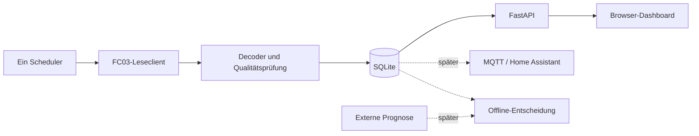

# Architektur und Modulgrenzen

Ein deploybarer Container: Python/FastAPI liefert API und gebautes React/TypeScript-
Frontend. Node wird nur zum Bauen benötigt. SQLite auf lokalem persistentem Volume.

## Komponenten

- Registerprofil: versionierte, freigegebene Gruppen; öffentliche Vollreferenz ist
  keine ausführbare Konfiguration. Nur die drei Kernblöcke sind Erstprofil-Kandidaten.
- Transport: enger FC03-Zugriff mit einer Deadline; streng MBAP/PDU/Unit/Transaktion
  prüfen. Fehler liefern Typ plus Anzahl bereits empfangener Bytes.
- Decoder: reine Funktionen, Signalherkunft und Gültigkeit. Kein I/O und keine
  stillschweigende Skalierung unbekannter Einträge.
- Sammler: endlicher Testmodus und später Dauerbetrieb; jeweils ein Besitzer der
  Geräteschnittstelle. Prozess-/Deployment-Sperre, kein Start pro Webworker.
- Repository/SQLite: Transaktionen für Messungen und Zustandswechsel; Ausfälle
  führen zum Stopp, statt weiter ungespeichert zu messen.
- API/UI: Lesen aus DB, kein Modbus beim HTTP-Refresh. Verwaltungsaktionen nur
  lokal in der App, validiert und zugriffsgeschützt.
- Ausgabeadapter später: MQTT unabhängig von der Verfügbarkeit des Brokers;
  Prognose und Steuerung bleiben getrennte Module und Datentypen.

## Konfiguration und Lebenszyklus

Die konkrete Umgebungsvariablen-/Dateischnittstelle wird in Issue zur Grundlage
implementiert. Vorgeschlagene Namen stehen in `.env.example`; diese Datei ist
eine Planungsvorlage und noch keine installierbare Anwendungskonfiguration.

Frische Installation: ohne konfiguriertes Ziel/Profil keine Geräteverbindung.
Kein automatischer Import, keine Suche, keine alte Standard-IP. Ein explizit
eingerichteter Betrieb darf nach normalem Neustart seinen dokumentierten Zustand
wieder aufnehmen; harter Stopp, manuelle Pause und Fehlerbudget bleiben erhalten.
Keine Wiederaufnahme während Backup/Restore oder bei fehlender Zustandsdatei nach
bereits erkanntem Speicherfehler. Die genaue Crash-Konsistenz wird getestet.

Shutdown: neue Anfragen sperren, laufende Anfrage höchstens bis Deadline beenden,
Speichertransaktionen abschließen, Zustand sichern, Verbindung schließen.
Mehrere Browser dürfen keine zusätzlichen Sammler starten. Das Deployment muss
auch konkurrierende Container für dieselbe Anlage verhindern bzw. erkennen;
kein alleiniger prozesslokaler Mutex als hinreichende Lösung behaupten.

Testbarkeit: Clock, Transport und Speichergrenzen injizierbar; Tests können Minuten
simulieren, ohne in Echtzeit zu warten. Abhängigkeiten pinnen, Plattformversionen
erst bei Implementierung anhand offizieller Dokumentation festlegen.
