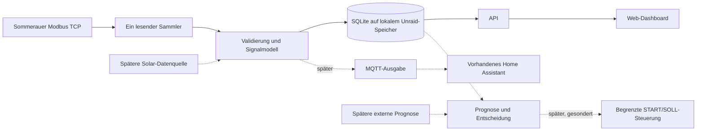

# Sommerauer Monitor – Arbeitsplan

Stand: 14.10.2026. Der Nutzer hat den Plan positiv bestätigt und Repository plus
Issues #2–#5 haben Projektgrundlage, Decoder, Transport/Simulator und SQLite geliefert;
Sammler, vollständiges Dashboard, Docker/Image und Geräteprüfung bleiben offen.
Konkrete Entwurfswerte unten sind Startwerte für die Implementierung, keine
Herstellerfreigaben. Keine neue Gerätekommunikation bei dieser Übergabe.

**Nachtrag 18.10.2026:** Der Betreiber hat die Fehlerstrategie für einzelne
Werte geändert: übrige Signale weiter erfassen und konkrete Ursachen an den
Kacheln zeigen. Fehlende optionale Wetterdaten sind „nicht verfügbar“;
wirklich ungültige Signale werden ohne automatische Wiederholung isoliert.
Übergreifende Geräte-/Protokoll-/Speicherfehler behalten den globalen Stopp.
Dies präzisiert die ursprüngliche pauschale Datenfehler-Stoppregel unten.
Aktueller Vertrag: [Fehlerverhalten](FEHLERVERHALTEN.md).

**Nachtrag 19.10.2026:** Der Betreiber ersetzt das Fehlversuchslimit durch
fortlaufendes Polling bei reinen Verbindungsfehlern im bestehenden Intervall.
Keine steigenden Retry-Pausen; endliche Prüfläufe und harte Stopps bleiben getrennt.

## 1. Festgehaltene Nutzerentscheidungen

| Thema | Entscheidung / Herkunft |
|---|---|
| Aktuelles Heizungsziel | `MODBUS_HOST` aus privater Konfiguration, laut Nutzer im Heimnetz erreichbar; von Codex noch nicht geprüft |
| Alte Adresse | die historische Laboradresse ist historisch; kein automatisches Ausweichziel |
| Betrieb | Docker-Anwendung auf Unraid **7.3.2**, Deployment durch Nutzer |
| Zugang | Heimnetz und vorhandenes Tailscale; kein öffentlicher App-Webzugang geplant |
| Erste Version | Modbus-Datenlogging und eigenes Web-Dashboard |
| Registerumfang | Bestätigte Kanäle plus schrittweise Prüfung weiterer Werte, etwa Außentemperatur, Leistung, Fehlercode |
| Historie | **Alle Minutenwerte dauerhaft behalten**, keine automatische Löschung/Verdichtung der Originalmessungen |
| Verbindungsfehler | Seit 19.10.2026 ohne Versuchslimit im regulären Intervall weiterlesen; harte Fehler und Read-to-clear-Schutz bleiben |
| Home Assistant | Läuft bereits; MQTT-Broker ebenfalls vorhanden. Integration später, jetzt vorbereiten |
| Spätere Übersteuerung | **START-/SOLL-Schwellen**, echte Sensorwerte bleiben unverändert |
| Prognose | Spätere bzw. externe Solarthermie-Prognose; jetzt Schnittstellen berücksichtigen |
| Veröffentlichung | Neuer App-Code darf in ein öffentliches Repository im GitHub-Profil des Nutzers |

Port 502, Unit 255 und FC03 stammen aus dem bisher bestätigten Projektprofil.
Ihre unveränderte Funktion unter der neuen IP wird erst bei der geplanten
Inbetriebnahme geprüft. Ein IP-Wechsel beweist keine neue erfolgreiche Messung.

## 2. Vorschlag für das erste Release

Arbeitsname **Sommerauer Monitor**, vorgeschlagener Repositoryname
`sommerauer-monitor`. Eine kleine eigenständige Anwendung ohne Cloudzwang.

### Dashboard und Verlauf

- Übersicht mit Kesseltemperatur, Puffer oben/unten, Anlagen-Betriebsstunden
  und den zusätzlich bestätigten Werten. Mobile Darstellung im Browser.
- Diagramme für letzte Stunde, 24 Stunden, Woche, Monat und freien Zeitraum.
  Gemeinsame Temperaturachse, separat darstellbare Zähler/Leistungswerte.
- Je Wert: Einheit, eigener Erfassungszeitpunkt, Datenalter und Qualitätsstatus.
  Fehlende Werte sind Lücken. Letzte bekannte Werte werden als veraltet
  gekennzeichnet, nie als gerade gemessen ausgegeben.
- Getrennte Zustände für App erreichbar, Erfassung aktiv/pausiert,
  Verbindung gestört und Datenfehler. Ein laufender Webserver beweist keine
  funktionierende Messung oder störungsfreie Heizung.
- Ereignisliste zu Ausfällen, Wiederverbindung, gestoppter Erfassung,
  Konfigurationswechseln und Speicherproblemen. CSV-Export nach Zeitraum.
- Erfassung lokal pausieren/fortsetzen und App-Einstellungen bearbeiten.
  Diese Funktionen verändern keine Heizungsparameter.

Nicht als Messwert darstellen: Pelletverbrauch, thermische Leistung in kW,
Brennerstarts, Flammenlaufzeit, nutzbarer Pufferenergieinhalt oder Solarertrag,
solange dafür keine passende Datenquelle und Umrechnung belegt ist. Der
vorhandene Betriebszähler ist der Anlagen-Betriebszähler, nicht automatisch
reine Brennerlaufzeit. Ein Fehlercode 0 beweist nicht alle Anlagenfunktionen.

### Datenumfang und Erfassungsplan

| Gruppe | Offset / Anzahl | Stand | Vorgeschlagenes Intervall |
|---|---|---|---|
| Kesseltemperatur | 4102 / 1 | Am alten Ziel live/Display bestätigt | 60 s |
| Betriebszähler | 28688 / 2 | Tage + Restminuten, live/Display bestätigt | 60 s |
| Puffer oben/unten | 36864 / 2 | Live/Display bestätigt | 60 s |
| Fehlercode + interne Istleistung | 4098 / 2 | In Tabelle vorhanden, bisher nicht live geprüft | Nach Prüfung 60–300 s, Plan noch festzulegen |
| Außentemperatur | 33408 / 1 | In Tabelle vorhanden, bisher nicht live geprüft | Nach Prüfung 300 s |
| Interne Sollleistung | 4104 / 1 | In Tabelle vorhanden, bisher nicht live geprüft | Nach Prüfung 300 s |
| Abgasfühler | 4354 / 1 | Optionaler nächster Kandidat, unbestätigt | Nach Prüfung 300 s |

Die Zusatzwerte sind **Kandidaten**, noch kein freigegebener Live-Testplan.
Zuerst die Bedeutung und Skalierung überprüfen, dann kleine begründete
Lesedurchgänge und erforderliche Displayabgleiche. Kein Abruf aller 199
Profilzeilen. Ein typisierter Registerkatalog hält Quelle, Datentyp, Einheit,
Skalierung, gültigen Bereich, Fehlerwerte und Prüfstatus je Signal fest.
Unbestätigte Einträge sind nicht automatisch zum Polling aktiviert.

Ein zentraler Scheduler koordiniert alle Gruppen: genau ein Client/eine
Anfrage gleichzeitig, FC03, maximal zwei Register pro Anfrage und 3 s
Gesamtdeadline. Kernwerte zunächst einmal pro 60 s, Zusatzgruppen verteilt
und langsamer. Werden mehr Gruppen aktiviert, muss der Zeitplan weiterhin
in diese Kapazität passen; keine Verdrängung der Intervalle durch angeblich
gleichzeitig fällige Werte. Verspätungen werden als solche erfasst, nicht
durch Bursts nachgeholt.

Die drei Kernabfragen ergeben maximal 4.320 Anfragen pro 24 Stunden bei
durchgehendem 60-s-Raster. Diese Rechengröße beschreibt den Vorschlag,
keine Hersteller-Verträglichkeitszusage. Ein Telegrammblock ist nicht
automatisch eine atomare Momentaufnahme aller darin enthaltenen Werte.

### Fehlerverhalten für den Dauerbetrieb

Betreiberentscheidung vom 19.10.2026, umgesetzt und offline geprüft:

- Reine TCP-Verbindungsfehler und Timeouts ohne Antwortbytes als Fehlerbeobachtung
  speichern; den betroffenen Block frühestens nach seinem normalen Intervall
  erneut lesen. Kernblöcke mindestens 60 s, Zusatzblöcke mindestens 300 s.
- Kein Fünf-Versuche-Limit, keine Backoff-Stufen und keine Erholungszyklen für
  einen Budgetreset. Andere fällige Blöcke laufen weiter, erfolgreiche Antworten
  werden unmittelbar wieder als Messungen gespeichert.
- Genau ein Client/eine Anfrage, unverändertes Ziel, Unit und explizite Auswahl;
  keine sofortigen Zusatzversuche oder nachgeholten Bursts.
- Alte reine Transportstopps eines unbeschränkten Laufs werden beim aktivierten,
  ebenfalls unbeschränkten Sammlerstart automatisch fortgesetzt. Keine
  Datenlöschung oder manuelle Budgetquittierung erforderlich.
- Nutzerpause, abgeschlossene/endliche Prüfläufe, Signalsperren und harte
  Protokoll-/strukturelle Daten-/Speicherstopps bleiben erhalten. Ungewisse
  Read-to-clear-Auslesungen werden nicht automatisch wiederholt.
- Fehlerhafte Einzelwerte und registerbezogene Modbus-Ausnahmen bleiben wie
  im Nachtrag vom 18.10.2026 isoliert. Teilantworten sind Protokollfehler,
  keine reine Nichterreichbarkeit. Fehlende Messungen bleiben Lücken.

Bestehende Einzeltestwerkzeuge und explizit endliche App-Läufe behalten ihren
sofortigen Fehlerstopp ohne automatische Wiederholung.
Vollständiger Vertrag: [Fehlerverhalten](FEHLERVERHALTEN.md).

## 3. Technischer Aufbau

Vorschlag: **Python/FastAPI**, **SQLite**, ein kleines mit **React/TypeScript**
gebautes Dashboard. Frontend und API werden aus demselben Container
ausgeliefert. Nur für den Build ist Node nötig. Die UI-Auswahl ist ein
Architekturvorschlag, keine bereits vorhandene Abhängigkeit.

Der Sammler läuft unabhängig von offenen Browserfenstern. Genau eine
Sammlerinstanz; mehrere Webworker oder mehrere Container dürfen keine
zusätzlichen Poller erzeugen. Die API liest gespeicherte Daten und erzeugt
beim Dashboard-Refresh keine Modbus-Anfrage. Hintergrundaufgaben bleiben
überschaubar; keine zusätzliche Redis-/Queue-/Zeitreihenserver-Pflicht.

Die vorhandenen Proben, Decoder und Testfälle liefern überprüfte Bausteine.
Der aktuelle `sommerauer_logger.py` ist auf die alte IP und 15 Minuten
begrenzt und wird nicht durch stilles Entfernen seiner Grenzen zum Dienst.
Die neue App erhält einen eigenen, getesteten Erfassungslebenszyklus und
ein enges Leseregisterprofil. In Version 1 kein Schreibendpunkt, kein
schreibender Modbus-Adapter und kein allgemeiner Registereditor.

### Speicherung und spätere Erweiterbarkeit

- Stabile Signal-IDs, z. B. `boiler.temperature`, `buffer.top_temperature`,
  `buffer.bottom_temperature`, `boiler.operating_minutes`.
- Pro Beobachtung: Erfassungszeit in UTC, Rohwort/Rohworte, dekodierter Wert,
  Qualitätsstatus, Datenquelle, Registerprofil-/Dekoderversion und Bezug
  zur jeweiligen Anfrage. Anzeige nach Europe/Vienna inklusive Sommerzeit.
- Werte nie still nachträglich umrechnen: Änderungen der Dekodierung müssen
  mit Version und Herkunft nachvollziehbar bleiben.
- Unveränderte Minutenmessungen dauerhaft behalten. Zusätzliche
  Stunden-/Tageszusammenfassungen beschleunigen lange Diagramme, ersetzen
  aber keine Originalmessung. Min/Max und Anzahl gültiger Werte mitführen.
- Diagnose-/Transportlogs separat begrenzen/rotieren; diese Aufbewahrung
  ist unabhängig von den dauerhaft erhaltenen Messwerten. Die historischen
  Originaldateien dieses Projekts werden nicht angerührt.
- Datenbankmigrationen, Versionsstand, konsistente Sicherung und getestete
  Wiederherstellung vorsehen. Speicherbelegung sichtbar; bei vollem oder
  nicht beschreibbarem Speicher keine ungespeicherten Reads fortführen.

SQLite liegt auf lokalem Unraid-Speicher und wird in den Container gemountet,
nicht als aktive DB über SMB/NFS betrieben. WAL erleichtert gleichzeitiges
Lesen und Schreiben, setzt aber lokale gemeinsame Speichermechanismen voraus.
Backups über die SQLite-Backup-API oder bei kontrolliert geschlossener DB;
nicht nur die aktive Hauptdatei herauskopieren.
Quellen: [SQLite WAL](https://www.sqlite.org/wal.html),
[SQLite Backup](https://www.sqlite.org/backup.html).

## 4. Unraid und Veröffentlichung

- Ein Docker-Image, nicht privilegiert, mit einem Webport und einem
  persistenten `/data`-Mount. Daten, Konfiguration und Sicherungen außerhalb
  des austauschbaren Container-Dateisystems.
- Ziel-IP lokal konfigurieren; neue Installation startet ohne automatisches
  Polling, bis Profil und Erfassungsbetrieb eingerichtet sind. Keine
  eingebaute Verbindung zur alten IP. Ein bestehender Fehlerstopp überlebt
  automatische Container-Neustarts.
- Dockerfile, Release-Image, Compose-Beispiel und Unraid-Template/Anleitung
  liefern. Unraid-Template deckt Port, Datenpfad, UID/GID und Konfiguration ab.
  Nutzer deployt; keine Änderung an dessen Server während dieser Planung.
- Heimnetz/Tailscale ist vorgesehen. Kein Aufbau öffentlicher Zugänge und
  keine Veränderung an Tailscale erforderlich. Zustandsändernde App-Funktionen
  wie Konfiguration/Erfassungssteuerung mit Zugriffsschutz versehen;
  keine frei erreichbare öffentliche Verwaltungsoberfläche.

Persistente `appdata`-Ablage und Template-Konfiguration entsprechen dem
[Unraid-Konzept für Container](https://docs.unraid.net/unraid-os/using-unraid-to/run-docker-containers/managing-and-customizing-containers/).
Der konkrete lokale Pool-/Datenpfad wird beim Deployment gewählt; keinen
bestimmten Namen wie `cache` als beim Nutzer vorhanden voraussetzen.

Für GitHub ein **separates neues App-Repository**. Öffentlich werden eigener
App-Code, bereinigte Registerdefinitionen, synthetische Testdaten, Anleitung
und Build-Dateien. Hersteller-Softwareexporte, rekonstruierter C#-Code,
Fotos, echte Logs, Nutzerdaten, lokale Konfiguration und Zugangsdaten
bleiben im privaten Übergabeordner. Nicht diesen gesamten Ordner hochladen.
Repositoryinhaber aus der angemeldeten GitHub-Identität feststellen, bevor
ein Repository angelegt wird. MIT als Lizenzvorschlag für den eigenen Code.
Repository und Issues werden mit diesem Übergabeauftrag angelegt; App und Image folgen erst bei Umsetzung.

## 5. Spätere Funktionen jetzt berücksichtigen

### Home Assistant

Ein optionaler MQTT-Ausgabeadapter publiziert bereits validierte App-Werte
an den vorhandenen Broker. Home Assistant liest nicht zusätzlich direkt
über Modbus. Stabile IDs, Einheiten und Qualitätsinformationen von Anfang
an so modellieren, dass MQTT Discovery, Gerätezuordnung und Verfügbarkeit
später ergänzt werden können. Broker-Fehler dürfen die lokale Aufzeichnung
nicht unterbrechen. In der ersten Version noch keine MQTT-Befehle zur
Heizungssteuerung. [Home Assistant MQTT](https://www.home-assistant.io/integrations/mqtt/)
und [MQTT-Sensoren](https://www.home-assistant.io/integrations/sensor.mqtt/)
dokumentieren Discovery und Verfügbarkeitsmeldungen.

### Solarthermie und Prognose

Messdaten, prognostizierte Daten und steuernde Vorgaben bleiben getrennte
Datentypen. Eine zukünftige Solar-Datenquelle kann dieselbe Signalstruktur
nutzen. Für Hanazeder FP-2 liegt noch keine bestätigte digitale Anbindung vor;
deren Daten erscheinen bis dahin nicht als gemessener Solarertrag.

Spätere Konfiguration: Puffer-/Kollektordaten, Standort/Ausrichtung/Neigung,
Wärmebedarf, Modellparameter und Datenquelle. Prognoseadapter liefert
Erzeugungszeit, Gültigkeit, Modellversion und zeitlichen Verlauf erwarteter
nutzbarer Wärme in kWh bzw. Puffertemperaturen samt Unsicherheit. Vorhersagen
mit damaligem Erstellungsstand archivieren, damit ein Vergleich mit späteren
Messungen keine nachträglich aktualisierte Prognose verwendet.

Eine Wetter-/PV-Prognose ist nicht automatisch Solarthermieertrag; zwei
Pufferfühler allein messen ihn ebenfalls nicht. Erst Vergleich/Kalibrierung,
dann Nutzung für Entscheidungen. Das Modell selbst bleibt ein späterer
Arbeitsumfang; der vorhandene Offline-Entscheider wird nicht als produktiv
kalibriertes Modell ausgegeben.

### START-/SOLL-Steuerung

App-Einstellungen, gewünschte Heizungsparameter und tatsächlich am Gerät
bestätigte Werte getrennt halten. Später Änderungen mit Ursprung, vorherigem
Wert, Zielwert, Bestätigung und Rückfall protokollieren. Die echten Sensorwerte
bleiben immer erhalten; kein Sensor-Override vorgesehen.

Modbus-START und Touch-START ändern aktuell denselben Parameter. Ein
geräteseitiger Ablauf auf den vorherigen Touch-Wert nach X Minuten ist
weiterhin nicht nachgewiesen. Steuerung ist daher ein eigenes späteres
Arbeitspaket mit geprüftem Stellweg/Rückfall, kein versteckter Schalter im
ersten Dashboard. Details: [START-Rückfall](START_RUECKFALL.md).

## 6. Umsetzungsschritte und Abnahme

1. **Plan festlegen:** Umfang und Repository sind bestätigt; technische Entwurfswerte
   bei Umsetzung prüfen. Diese Übergabe enthält noch keine App-Implementierung.
2. **Erfassung und Speicherung offline:** Decoder/Profil, Scheduler,
   Datenqualität, Fehlerzustände, SQLite und Migrationen. Tests mit
   synthetischen Antworten und lokaler Simulation; keine Heizungs-Schreibwege.
3. **Dashboard:** Übersicht, Verlauf, Fehler/Alter, Erfassungssteuerung,
   lokale App-Konfiguration, CSV-Export. End-to-End-Prüfung mit Simulator.
4. **Neue IP und Zusatzregister prüfen:** eigene begrenzte konkrete Read-Pläne,
   zuerst bekannte Kanäle; Zusatzregister getrennt und nur begründet.
   Clientkonflikte mit bestehenden Lesern ausschließen. Keine neuen
   Parameter-/Tabellenimporte automatisch aus diesem Plan ableiten.
5. **Unraid-Paket und Inbetriebnahme:** begrenzter Erstlauf, dann gestufter
   dokumentierter längerer Lauf mit Anfragebudget; erst nach Auswertung
   den ausdrücklich vorgesehenen Dauerbetrieb aktivieren. Docker-Neustart,
   Fehlerfortsetzung, Datenpersistenz, Backup/Restore und Zeitzonen prüfen.
6. **Öffentliche Ausgabe:** sauberes App-Repository, CI-Tests, dokumentiertes
   Release/Docker-Image, Deployment-Anleitung. Nutzer übernimmt Deployment.
7. **Ausbau:** MQTT/Home Assistant zuerst als lesende Ausgabe; danach
   Solar-Datenquelle/Prognose und später gesonderte START-/SOLL-Steuerung.

Version 1 ist fertig, wenn Minutenwerte nachvollziehbar gespeichert und
dauerhaft erhalten bleiben, das Dashboard echte Datenlücken zeigt,
Verbindungsfehler das reguläre Polling nicht abbrechen, harte Fehler stoppen, Container-Neustarts
die Historie erhalten und ausschließlich dokumentierte Reads ausgeführt
werden. Eine schöne Demo ohne diese Betriebseigenschaften genügt nicht.

## 7. Noch nicht festgelegt

- Repositoryname `sommerauer-monitor` ist bestätigt. Lizenz noch offen; Vorschlag MIT.
- Priorität/Reihenfolge der Zusatzregister nach fachlicher Vorprüfung.
- App-Zugriffsschutz und lokale Unraid-Datenablage bei der Implementierung.
- X Minuten, zulässige Temperatur-/Zeitgrenzen und realer Rückfallmechanismus
  gehören zur späteren Steuerung und blockieren Version 1 nicht.

Keine weiteren Angaben zum Wettermodell oder zur Solarhardware für den
Beginn der Monitoring-Implementierung erforderlich. Rückfragen dazu erst
beim jeweiligen Ausbau stellen.
